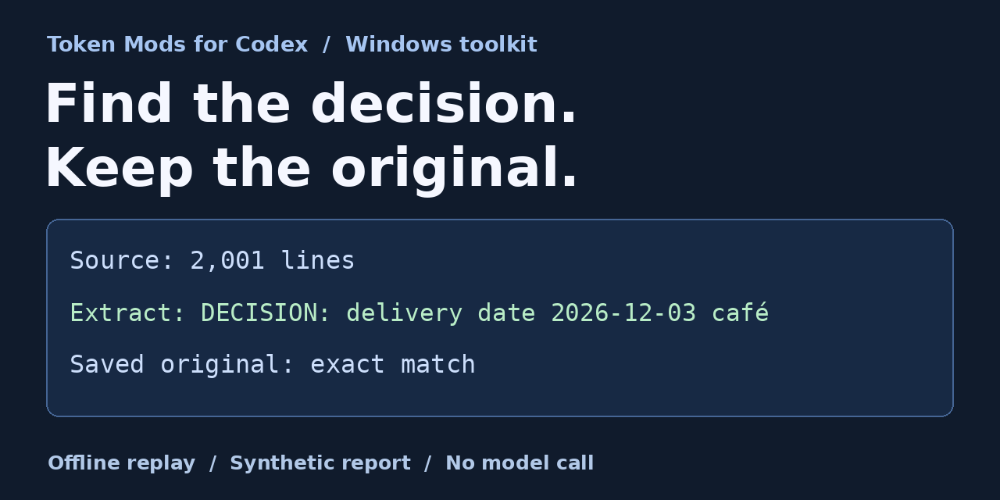

# Token Mods for Codex · Context management and token usage on Windows

**Scenario.** A developer asks Codex for the delivery date buried in a 2,001-line report. Token Mods returns the line with the delivery date (`2026-12-03`) and saves the full tool result on disk.

**Value.** The developer can work with the short extract and reopen the original when someone asks for the exact wording. When the chat gets long, a saved handoff lets the next session pick up the work.



The offline example runs the plugin hook on a synthetic report and checks the saved copy character by character. Run it with Python from the source checkout. [Read the replay](examples/replay_read.py)

```powershell
py -3 examples/replay_read.py
```

**[Download the Windows installer ZIP](https://github.com/jpet121/Codex-Token-Mods/releases/download/v1.1.0/Token-Mods-Windows-Team.zip)** · [Install and run your first chat](START_HERE.md) · [Release notes and checksum](https://github.com/jpet121/Codex-Token-Mods/releases/tag/v1.1.0)

## Three requests to try in Codex

| Ask Codex | What to look for |
| --- | --- |
| “Read this report for the decisions and caveats.” | An extract for an eligible large read. Ask “Show the full result” when you need exact wording. |
| “Give me a handoff for this chat.” | A saved continuation draft based on captured turns. Available tool and Git evidence helps the next session resume the work. |
| “Show token usage for this chat.” | Observed input, cached-input, and output counts when Codex supplies them. Worker overhead is reported separately where available. These counts alone cannot establish a dollar saving. |

## The nine helpers

| Helper | What it does |
| --- | --- |
| **Mods** | Shows settings and changes them globally or for one chat. Resuming restores the prior choices. |
| **Input Router** | Shortens eligible file and connector reads, keeps the original, and preserves available pagination fields. |
| **Handoff** | Builds a continuation draft from captured turns. A semantic handoff uses an optional model call. |
| **Savings Proof** | Reports observed usage and missing measurements. Compares workloads when task, input, model, effort, and acceptance checks match. |
| **Cache Clock** | Shows request age and measured cache reads. Future cache expiry is unknown. Cache warming is off. |
| **Effort Optimizer** | Suggests effort for a task. The desktop model and effort picker stays under the user's control. |
| **Model Router** | Runs a requested independent worker with the configured or selected model. |
| **Research Router** | Plans bounded research, checks sources, and returns a cited synthesis. |
| **Efficient Browser Use** | Creates smaller local image previews and maps coordinates back to the original. |

## Install and operate

Use Windows, Python 3.10 or later, and a signed-in Codex CLI that supports plugins and hooks. Extract the ZIP. In the folder that contains `install.py`, run `py -3 install.py`. Review the nine hooks, start a fresh Codex chat, and ask **“Token Mods, status.”** The [quick start](START_HERE.md) covers first use, pause, resume, and removal.

The first install downloads Python dependencies. Local tools need no separate API key. Captured prompts, replies, source originals, and usage records go under `%USERPROFILE%\.codex-token-mods`. Review a handoff before sharing it. Automatic paid notes are off by default. Requested research, semantic reading, and independent workers use your Codex account.

## Verification and attribution

[](https://github.com/jpet121/Codex-Token-Mods/actions/workflows/verify.yml)

The repository includes checks for source recovery, PDF reading, handoffs, usage reporting, and chat selection. The recorded live Windows verification used Codex CLI `0.171.0-alpha.13` and desktop package `26.1117.4957.0`. All 45 offline checks and the source-recovery example passed on both Windows and Linux. [View the public run](https://github.com/jpet121/Codex-Token-Mods/actions/runs/45658697476)

Jan Petreczko adapted the Claude toolkit for Codex. The upstream credits and Model Router license are included. [Verification record](VERIFICATION.md) · [Third-party notices](THIRD_PARTY_NOTICES.md)
